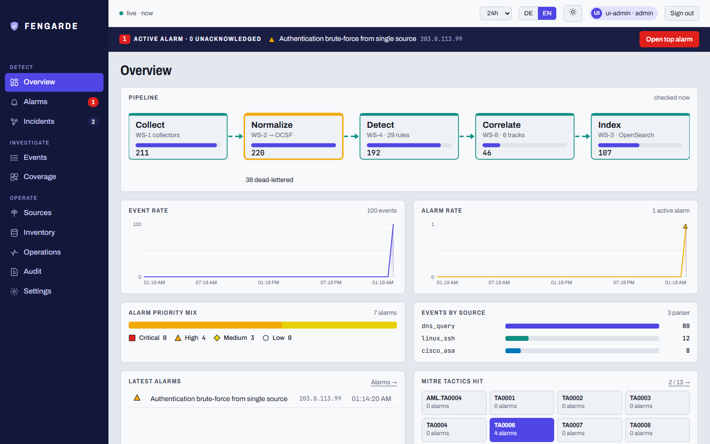
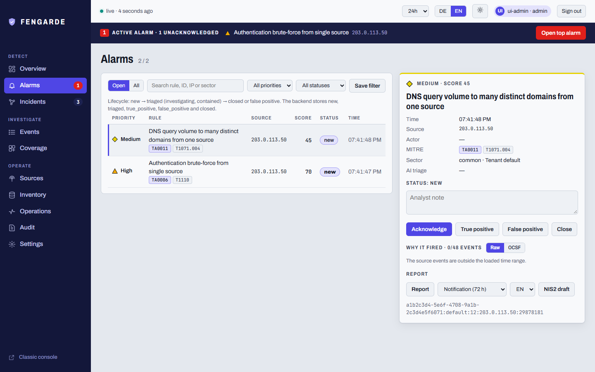
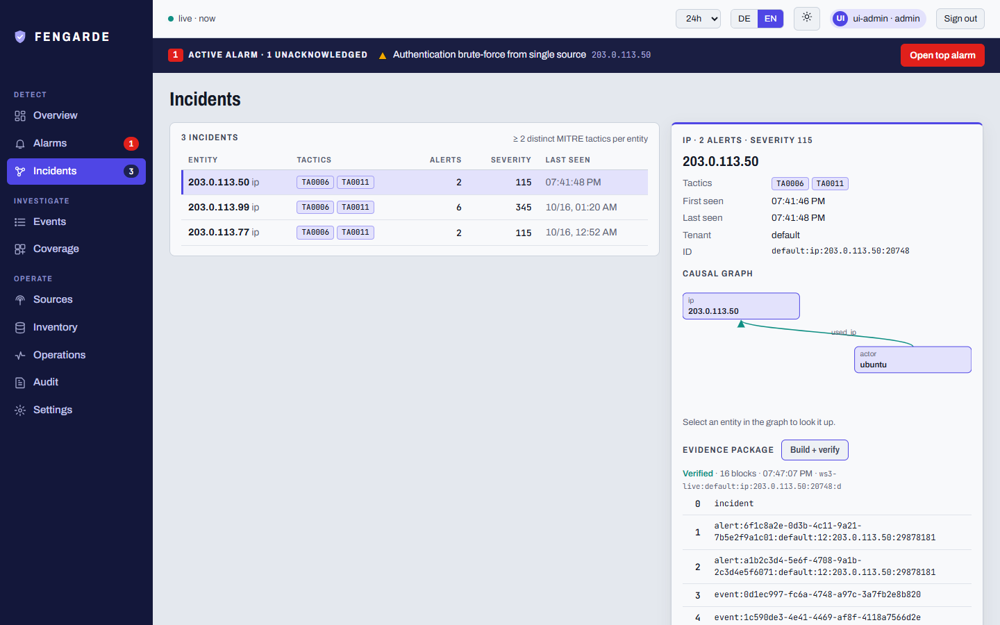
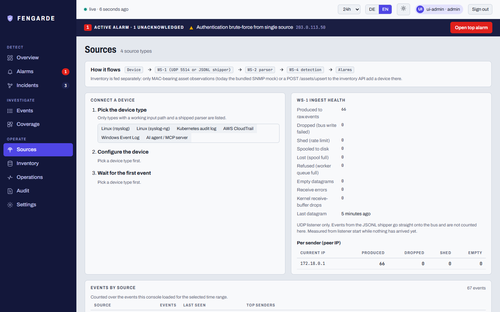
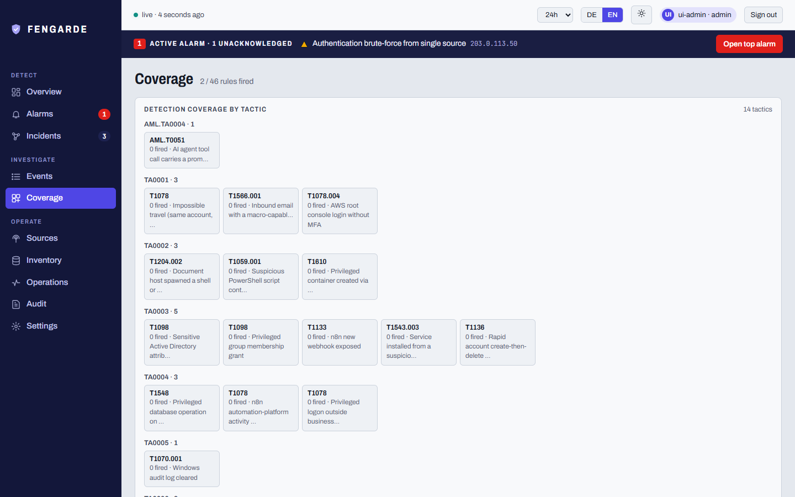

<p align="center"></p>

<h1 align="center">FENGARDE</h1>

<p align="center"><a href="https://www.bestpractices.dev/projects/14443"></a></p>

<p align="center"><b>Logs in. Evidence out.</b><br>
Open-source security pipeline for IT, AI and OT: raw logs to a verified incident and a draft NIS2 notification.</p>

<p align="center">
<a href="https://supermhel.github.io/fengarde/"><b>Project page and live demo</b></a> ·
<a href="#quickstart">Quickstart</a> ·
<a href="#the-console">Console</a> ·
<a href="#architecture">Architecture</a> ·
<a href="SSOT.md">Status (SSOT)</a>
</p>

<p align="center">
<a href="https://github.com/supermhel/fengarde/actions/workflows/ci.yml"></a>
<a href="https://github.com/supermhel/fengarde/actions/workflows/codeql.yml"></a>
<a href="https://securityscorecards.dev/viewer/?uri=github.com/supermhel/fengarde"></a>

</p>

<p align="center"><a href="https://supermhel.github.io/fengarde/"></a></p>

> Badges reflect the latest real run on `main`, not a promise. Scorecard's
> remaining findings are accepted, documented trade-offs, not gaps; see
> [SSOT.md](SSOT.md) §1.

**FENGARDE connects security telemetry across IT, AI and OT to show what
happened, who or what acted, what was affected, how the events relate, and
what evidence supports the conclusion.**

Built for the European industrial Mittelstand: open source, self-hosted,
Apache-2.0, with a draft NIS2 incident-notification path, a deterministic
German/English report generator, opt-in RBAC/MFA/audit-log/multi-tenancy for
MSP-style deployments, an opt-in HA profile (live-kill-tested, not just
wired), and AI triage that never leaves your network.

Logs are collected, normalized to one schema ([OCSF](https://schema.ocsf.io/)),
run through correlation rules over a sliding window, grouped into incidents with
a causal graph and a hash-chained evidence package, and indexed in OpenSearch.
Every service is independent and talks to the rest only through a message bus,
so any piece can be scaled or replaced without rewriting the others.

## Why FENGARDE

- **OCSF-native, not retrofitted.** Every source normalizes to the same open
  schema from day one, so one rule covers every source that emits the event: an
  SSH login, a Windows login and an Active Directory login are one brute-force
  detection, not three. No vendor log-format lock-in.
- **OT and IT in one pipeline.** OPC UA and Modbus/TCP normalize into the same
  schema as Active Directory, Windows and your firewall, so the plant floor runs
  through the same detection engine, console and report path as the office
  network, not a second toolchain.
- **AI triage that never leaves your network.** Local Ollama when `OLLAMA_URL` is set; otherwise a
  labelled deterministic stub. Alert data is never piped through a third-party LLM
  API, and the console names which engine actually ran.
- **Evidence, not just alerts.** Incidents carry a typed causal graph and a
  Merkle hash-chain evidence package that the API verifies before serving it.
- **Honest status.** What is proven, what is claimed and what is stubbed is
  written down in [SSOT.md](SSOT.md) and enforced by tests; this README only
  summarizes it.

> **OpenSearch, not Elastic:** no license asterisk on the storage engine
> ([ADR 003](docs/adr/003-opensearch-not-elasticsearch.md)). Worth knowing, but
> not a differentiator against Wazuh (its indexer is an OpenSearch fork too).

---

## Try it

| Way | Needs | What you get |
|---|---|---|
| **[The project page](https://supermhel.github.io/fengarde/)** | A browser | The real console on a *recording* of a lab run, with a replayable attack, the architecture, all 46 rules and four recorded walkthroughs. Static; writes stay in your browser ([`docs/console-demo.md`](docs/console-demo.md) says exactly what is real). |
| **`make e2e`** | Python 3 | SSH brute-force to a real alert, idempotent under replay. No Docker, Redis or OpenSearch. |
| **`make demo`** | Docker | The full live stack; a real brute-force alert appears in the console within about a minute. |

## Quickstart

```sh
git clone https://github.com/supermhel/fengarde.git && cd fengarde
make preflight   # doctor: checks vm.max_map_count, Docker RAM, free ports
make demo        # docker compose up -- a real SSH brute-force alert appears
                 # in the dashboard within ~30-60s, no manual step
# open http://localhost:8080
```

No Docker on hand? The whole detection pipeline runs zero-infra:

```sh
make e2e         # SSH brute-force -> real alert -> idempotent replay, no Docker/Redis/OpenSearch
bash tools/demo.sh   # same test, narrated (Windows: powershell -File tools\demo.ps1)
```

**What you're seeing:** 10 failed logins from one IP within 60 seconds (SSH
`Failed password` or Windows `EventID 4625` — both normalize to the same OCSF
Authentication event) trip
[`common_bruteforce.yml`](contracts/rules/common_bruteforce.yml)
(`threshold: 10`, `window_seconds: 60`, grouped by source IP), and the alert
lands in the dashboard's alert list, idempotent under redelivery.

**Prerequisites:** Docker Desktop or Docker Engine + Compose v2, ≥4 GB RAM
allocated to Docker; Linux, macOS, or Windows via WSL2 (Linux containers,
POSIX `sh` scripts). Python 3 only if you're contributing a parser — no
Docker needed for that (see [Contributing](#contributing)).

<details>
<summary>Linux/WSL2: OpenSearch needs <code>vm.max_map_count</code> raised first</summary>

```sh
sudo sysctl -w vm.max_map_count=262144
# persist across reboots:
echo 'vm.max_map_count=262144' | sudo tee /etc/sysctl.d/99-fengarde.conf
```

Without it, OpenSearch fails with a JVM crash, not a helpful error. Not
needed on macOS Docker Desktop (handled inside its VM). `make preflight`
checks this for you and prints the exact fix if anything's missing.

</details>

Other targets:

```sh
make test     # full zero-infra contract test suite, no Docker needed
make up       # start the stack detached
make down     # stop the stack, remove volumes
make ha-up    # opt-in: Redis Sentinel + 3-node OpenSearch HA (needs REDIS_PASSWORD)
make ha-down  # stop the HA profile, remove its volumes
```

| Port | Service | What it is |
|------|---------|------------|
| 6379 | `redis` (`siem-bus`) | Message bus between services |
| 9200 | `opensearch` (`siem-store`) | Event/alert storage + query API |
| 5601 | `dashboards` (`siem-dashboards`) | OpenSearch Dashboards |
| 8000 | `ws6-inventory` | Inventory API (IP/MAC history) |
| 8080 | `ws7-dashboard` | FENGARDE alert console |
| 5514/udp | `ws1-collectors` | Live syslog ingestion (unauthenticated — trusted segment only) |
| 8013 | `ws3-indexer` | Triage API — internal only, not published to the host |
| 9090 | `prometheus` | Metrics — opt-in, `observability` compose profile |
| 3000 | `grafana` | Dashboards over Prometheus — opt-in, same profile; default `admin`/`admin`, see `SECURITY.md` §1 |
| 8081 | `goatcounter` | Self-hosted visit counter for a self-served copy of the project page — opt-in, same profile; cookie-free, nothing leaves your network (set up once via `docker exec`, see `docs/deployment.md`) |

`make preflight` checks the published ports are free before you start.

---

## The console

After `make up` the console is at `http://localhost:8080` (React 18 and Vite; the previous
single-file UI at `/legacy/` was retired on 2026-10-20). Eleven views (ten in the sidebar plus Account) in three groups:

| Group | Views |
|---|---|
| **Detect** | Overview, Alarms (triage, AI verdict, "why it fired", NIS2 draft), Incidents (causal graph, evidence package, incident report) |
| **Investigate** | Events (query bar, facets, histogram, raw/OCSF), Coverage (MITRE heatmap, all rules, per-tenant switch for admins) |
| **Operate** | Sources (connect a device, wait for its first event), Inventory (live asset record, add a device as admin), Operations (service health, dead letters, Prometheus panel), Audit, Settings (users and notification channels, admin only) |
| **Account** | MFA enrolment |

German and English, light and dark, phone widths. Sign-in accepts an MFA code
and says which host it talks to, whether the sign-in service answers, and warns
on plain HTTP. What each role may do is listed on the sign-in page.

| | |
|---|---|
|  |  |
|  |  |

Recorded walkthroughs (`docs/video/`): attack to evidence, sign-in to settings,
analyst triage with the NIS2 draft in German, connecting a device. Everything
above is driven on a live stack by [`tools/console_e2e`](tools/console_e2e/README.md)
as admin, analyst and read-only, in both languages, in dark mode and at phone width.

---

## What is real

Summary of `main` (last tagged release: `v0.11.3`). The itemized history is
[CHANGELOG.md](CHANGELOG.md); the authoritative, continuously updated status is
[SSOT.md](SSOT.md). If they disagree with this table, SSOT wins. Measured,
externally-usable detection numbers (macro-F1, per-rule TP/FP/FN/TN, twin
scorecard — with units, methodology and the honest limits):
**[`benchmark/`](benchmark/)**.

Rows marked **(console rebuild)** describe the rebuilt console, its admin APIs
and the demo, merged in [PR #100](https://github.com/supermhel/fengarde/pull/100)
and released in v0.11.0. Phase 5 ([PR #92](https://github.com/supermhel/fengarde/pull/92)) is merged.

**Pipeline and detection**

| Capability | Status | Notes |
|---|---|---|
| Detection pipeline (collect, normalize, detect, index, console) | ✅ Works | End-to-end since v0.1 |
| **Parsers (19)** | ✅ Works | Cisco ASA, Active Directory, VMware vSphere, Linux SSH, generic syslog, Windows Event Log, DB audit, MCP/AI-agent tool-call audit, OPC UA/OT audit, n8n audit, DNS query log, Kubernetes audit, CEF, AWS CloudTrail, Sysmon, Modbus/TCP anomaly detector, inventory-diff OT device detector, mail gateway, M365 audit; all to OCSF |
| **Live syslog routing** (console rebuild) | ✅ Works | A forwarded sshd, Cisco ASA or CEF line (also behind a syslog header) reaches its own parser, not the generic one; proven by a real UDP burst that raised the brute-force alarm |
| **Detection rules (46)** | ✅ Works (43 stable; 3 experimental: `common_impossible_travel` (cannot fire on production traffic until a deployment supplies real egress prefixes or a GeoIP resolver), `common_credential_stuffing_sustained` and `ot_opcua_write_unauthorized_node`. 7 of the 2026-10-20 Windows/spray/sweep rules are proven by unit tests and fire checks, not yet by a twin storyline) | Brute-force, port-scan, lateral movement, password spray, privileged-group grant, after-hours admin, impossible travel, bank DB privilege escalation, mass VM delete, AI-agent rules (credential files, tool-call burst, prompt injection, destructive command, non-allowlisted egress), OT rules (write outside maintenance, new engineering connection, config change, Modbus unauthorized write, new device on segment), n8n, DNS exfiltration, privileged container, cloud root login, mass DB read, rapid account churn, beaconing. The full list is on the [project page](https://supermhel.github.io/fengarde/) |
| Rule grammar and prefilter | ✅ Works | Boolean logic, comparisons, allowlist suppression (CIDR and exact), time of day; fails closed on malformed input; rules bucketed by `class_uid` |
| Anti-dormancy and rule-boundary guardrails | ✅ Works | CI proves every rule is satisfiable by a real parser's output and that declared thresholds are enforced (`python eval/attack/fire_check.py`, 2026-10-22: 20 stateful and 25 stateless rules held; all 45 MITRE-tagged rules fire; one untagged rule is unverified): engine-versus-declaration agreement, not a claim that thresholds are well chosen |
| **Cross-alert correlation** (WS-8) | ✅ Works | Promotes an incident once an entity shows two or more distinct MITRE tactics; deterministic `incident_id`; bounded memory |
| **Causal incident graph** | ✅ Works | Typed DAG per incident, each edge grounded in one alert's own evidence, never a transitive inference |
| Entity resolution (WS-9) | ✅ Works | Deterministic entity ids, idempotent under redelivery |
| Chaos-tested delivery | ✅ Works | `make chaos`: 40 scenarios, every pipeline service SIGKILLed mid-replay, zero lost and zero duplicate alerts |
| HA profile (Redis Sentinel and 3-node OpenSearch) | ✅ Works, opt-in | `make ha-up`; Sentinel failover (about 1 s promotion, zero lost messages) and OpenSearch write round-robin both live-kill-tested |

**Analyst workflow**

| Capability | Status | Notes |
|---|---|---|
| **Console (React)** (console rebuild) | ✅ Works | Eleven views, DE/EN, light/dark, phone widths, MFA sign-in. `check.mjs` (90 checks across three roles) and `mfa.mjs` pass against the live stack |
| **Static console demo** (console rebuild) | ✅ Works | `npm run build:demo`: the real console on a recording of a lab run (`docs/demo/`), with an attack replay; labelled as recorded data |
| Triage workflow | ✅ Works | Status and note per alert; concurrent writes protected (lock plus OpenSearch optimistic concurrency) |
| AI triage (local Ollama) | ✅ Works, opt-in | `OLLAMA_URL` enables it (no default; unset means the stub), `OLLAMA_MODEL` picks the model (default `qwen2.5`); unset or unreachable degrades to a deterministic offline stub with no network calls; per-rule `llm_gate: false` opt-out; bounded concurrency |
| Alert and incident reports | ✅ Works | Generic markdown draft and a deterministic German/English NIS2 Art. 23 / §32 BSIG draft (3 stages, 2 languages); entity-specific facts are explicit `[ANALYST MUST PROVIDE]` placeholders, never fabricated; incident-level draft built from the verified evidence package |
| Evidence package | ✅ Works | Merkle hash chain over an incident's alerts, events and graph; the route verifies before serving (409 on failure, never a silent unverified 200) |
| OT business context and exposure scoring | ✅ Works, opt-in | `contracts/ot-points/*.yml` adds plant, line, owner and criticality to OT alerts and real points to their score |

**Operating it**

| Capability | Status | Notes |
|---|---|---|
| Opt-in auth, RBAC, MFA/TOTP, audit log | ✅ Works, opt-in | API key, basic-auth, Redis `AUTH`; per-user roles with tenant scoping, session cookies, CSRF; RFC 6238 TOTP; append-only audit trail. Unset stays open |
| Redis-backed sessions | ✅ Works, opt-in | Every session row HMAC-signed; `FENGARDE_SESSION_SECRET` required |
| Multi-tenancy | ✅ Works | `tenant_id` end to end; per-tenant indices, rule enablement and fair consume ordering |
| **Admin APIs** (console rebuild) | ✅ Works, opt-in (RBAC) | `/users`, `/webhooks` (redacted), `PUT /rules/{id}/enabled` (WS-4 honours it within a request), `POST /inventory/assets`; admin only, CSRF, audited |
| Versioned REST API | ✅ Works | OpenAPI 3.1 (`contracts/triage-api.yaml`), bare or `/api/v1/...`; spec-versus-code drift is CI-tested |
| Outbound webhooks | ✅ Works, opt-in | HMAC-SHA256 signed; see [`docs/webhooks.md`](docs/webhooks.md) |
| Parser and rule plugins | ✅ Works | Entry-point packages, no fork needed; see [`docs/plugin-development.md`](docs/plugin-development.md) |

**Validation**

| Capability | Status | Notes |
|---|---|---|
| AI-to-OT digital twin (`eval/twin/`) | ✅ Works | Offline harness (PLC simulator, attack scenario, oracle, negative controls); every number harness-measured, honest `null` where nothing exists to measure |
| Adversarial mutation validation (`eval/adversarial/`) | ✅ Works | Blocking mutation matrix (8 axes), curated corpus, and an advisory nightly LLM-composed adversary that never blocks CI |
| `eval/trend.jsonl` viewer | ✅ Works | Static render of the nightly detection-quality and twin scorecard history |

**Not done**

| Capability | Status | Notes |
|---|---|---|
| SNMP, NetFlow, custom-JSON, proxy parsers | 🚧 Planned | SNMP/NetFlow read mock files today; [good first issue](CONTRIBUTING.md) |
| RFC 5424, TCP/TLS syslog | 🚧 Planned | UDP RFC 3164 only; the Sources view says so |
| S7/PROFINET parser | 🚧 Deferred | Needed vocabulary sits behind a Siemens support login |
| Prometheus health panel with data | ⚠️ Not proven | The unreachable state is tested; the populated state is not |

> **No AI required.** The pipeline produces real alerts with zero infra and no LLM;
> Ollama triage is an optional layer that degrades gracefully to a stub.

---

## Architecture

```
WS-1 Collectors ─raw.events─▶ WS-2 Normalization ─normalized.events─┬─▶ WS-3 Indexer ─▶ OpenSearch
   (Cisco ASA / AD /          (parsers → OCSF)                      └─▶ WS-4 Detection ─scored.events─▶ WS-3
    VMware / Linux SSH)                                                  │  alerts ─▶ WS-3, WS-8, WS-9
   ─assets.updates─▶ WS-6 Inventory (IP/MAC) ─raw.events─▶ (new device -> WS-2, feedback loop)
                                                                          └─ai.requests─▶ WS-5 AI (real local
                                                                                Ollama triage, stub fallback)
                                                                                ─ai.results/alerts─▶ WS-3
WS-8 Correlation ◀─alerts (2nd consumer group)── multi-tactic entity tracks ─incidents─▶ WS-3
                    └─ incident.graph (typed causal DAG, v2) ─▶ WS-3 (persists + serves; dashboard renders it)
WS-9 Resolver ◀─alerts (3rd consumer group, entity extraction)── entity.updates ─▶ WS-3 (persists + serves `GET /entities/{id}`)
WS-7 Dashboard ◀── HTTP only (nginx → WS-3's triage/report/rules/incidents/entities/evidence API + WS-6's inventory API), never the bus
```

The **only** coupling between backend services is the message bus — no
service calls another's code or API directly. Everything else is a frozen
contract under [`contracts/`](contracts/). All source-format heterogeneity is
absorbed at the edge (one parser per source in WS-2); the interior of the
system handles a single schema (OCSF). WS-7 is the one exception by
necessity: a browser UI, so it reaches WS-3/WS-6 over HTTP via nginx — it
never touches the bus, and no backend service depends on it.

| WS | Service | Role |
|----|---------|------|
| 1 | `services/ws1-collectors` | Collect logs → `raw.events` |
| 2 | `services/ws2-normalization` | Parsers → validated OCSF events (19 parsers) |
| 3 | `services/ws3-indexer` | Routing + OpenSearch indexing; entity/incident-graph/evidence read routes |
| 4 | `services/ws4-detection` | Correlation rules + scoring + windowing (46 rules) |
| 5 | `services/ws5-ai` | Triage — real local-LLM (Ollama), stub fallback, bounded concurrency |
| 6 | `services/ws6-inventory` | IP/MAC inventory API (SQLite); stores sector and type; thread-safe reads |
| 7 | `services/ws7-dashboard` | Console (React); a static demo build for the project page |
| 8 | `services/ws8-correlation` | Cross-alert correlation + causal incident graph |
| 9 | `services/ws9-resolver` | Deterministic entity resolution (`entity.updates`) |

For current status and the forward roadmap, see **[SSOT.md](SSOT.md)** (read that first).
For historical design context: [`docs/archive/PHASE0_README.md`](docs/archive/PHASE0_README.md).

---

## Performance

Measured 2026-10-28 on one laptop (Intel i5-8365U, 4C/8T, 15 GB, Windows 11,
Docker Desktop 8 vCPU / 7.9 GB), shared with other running Docker projects.
Full method, tables, raw outputs and limits: **[`benchmark/loadtest.md`](benchmark/loadtest.md)**.

```sh
python tools/fengarde_loadtest.py --repeat 3 --max-events 20000   # zero-infra, no Docker
python tools/fengarde_bench.py --events 20000 --mixed             # older one-shot batch baseline
```

| Zero-infra (46 rules, in-memory bus, realistic mix, median of 3) | Value |
|---|---|
| WS-2 normalize, events/s (p50 / p95 per event) | ~2,100 (0.34 ms / 1.1 ms) |
| WS-4 detect, events/s (p50 / p95 per event) | ~4,500 (0.08 ms / 0.6 ms) |
| End to end, paced: highest rate sustained | 500 events/s (p50 3.5 ms, p95 22 ms); 1,000 events/s was not sustained |
| End to end, unpaced ceiling | ~1,160 events/s (range 870-1,460) |
| Alert-heavy stress mix (~1.3 alerts per event), unpaced ceiling | ~250 events/s |
| Peak resident memory, 20,000 events | <100 MB |

These are CPU-bound single-process ceilings for this host (no Redis or OpenSearch
I/O). The previous rows (~985 / ~2,500 events/s, ~114 MB) did not reproduce and
are retired.

```sh
# live stack: isolated compose project, procedure in benchmark/loadtest.md
python tools/fengarde_loadtest_live.py --rates 25 50 75 100 150 200 --step-s 60 --out benchmark/raw/live-ramp
```

| Live stack (Redis streams + OpenSearch) | Held for 12 min | Falls behind | Limiting stage |
|---|---|---|---|
| Original: ws3 writes one document per HTTP request | 20 events/s | ~25 events/s | `ws3-indexer` (~50 docs/s per OpenSearch single PUT vs ~4,700 via `_bulk`) |
| + ws3 bulk writes, 1 WS-4 replica | 60 events/s (alert backlog drifted up) | ~100 events/s | WS-4 consume path: Redis window-counter round trips (~78% of its per-event time) |
| + batched alert writes, **3 WS-4 replicas** | **100 events/s, alert backlog flat** | not found; 200 events/s kept pace, 300-400 inconclusive (neighbour load) | not reached |

`index_failed` on the OpenSearch node counted create-only 409 conflicts (by
design, not failures); evidence in `benchmark/loadtest.md` section 3c. Scaling
WS-4 is `docker compose up -d --scale ws4-detection=3` (the window counter is
global in Redis for exactly this); it trades strict per-source event order for
throughput.

**This is a laptop-scale result, not SIEM-scale.** One laptop shared with other
Docker projects, one replica per service, 512 MB OpenSearch heap. The live stack
holds on the order of 100 events/s with three WS-4 replicas (tested for 12
minutes), not thousands. Nothing above 400 events/s offered, no multi-node
OpenSearch, ran under other Docker projects' load, and nothing longer than 12
minutes was tested. The older `tools/fengarde_bench_live.py` (~43.9 events/s,
5,000-event drain, pre-bulk) remains a manual one-shot.

---

## Evaluation & detection quality

"A rule passes CI" and "a rule actually fires on real attack traffic" are
different claims — this repo keeps them separate across three eval lanes
under `eval/`:

| Command | What it proves | Needs |
|---|---|---|
| `make attack-scorecard` | Declared MITRE ATT&CK/ATT&CK-ICS/ATLAS coverage, an empirical check that every tagged rule fires on its own real producer fixture, and a boundary check that stateful rules stay silent under-threshold/past-window — three distinct claims | Zero infra |
| `make eval-detection` | Independent-oracle replay: real Windows Security/Sysmon attack corpora (EVTX-ATTACK-SAMPLES, splunk/attack_data) through the live pipeline, checked against a ground truth computed separately from the engine's own logic. See [`eval/detection_accuracy/README.md`](eval/detection_accuracy/README.md) for licensing/setup (both corpora are third-party, not vendored) | Real datasets fetched separately |
| `make nis2-demo` | A real alert becomes a structurally-compliant NIS2 draft, across 12 synthetic scenarios × 3 stages × 2 languages | Zero infra |
| `python tools/detection_quality_eval.py` | Precision/recall/F1 regression trip-wire against a small hand-labeled corpus, including adversarial labels that keep it honest — engine-vs-labels agreement, not a real-world quality bar | Zero infra |

`attack-scorecard`, the report-generator eval, and the detection-quality
canary all run in `run_all_tests.sh`; `eval-detection` is dataset-gated so
it's excluded from the zero-infra gate, but it's the harness that has
actually caught real false negatives in shipped rules.

---

## Contributing

The fastest way to contribute is to **add a parser** — no Docker or OpenSearch needed:

```sh
cd services/ws2-normalization && python test_contract.py
```

See **[CONTRIBUTING.md](CONTRIBUTING.md)** for the contribution workflow and
**[docs/adding-a-parser.md](docs/adding-a-parser.md)** for a step-by-step walkthrough
(copy `linux_ssh.py`, make three small edits, verify). The parsers marked
🚧 Planned above are the obvious first PRs — or propose a new detection rule via the
[rule request template](.github/ISSUE_TEMPLATE/rule_request.md).

Participation is governed by the [Code of Conduct](CODE_OF_CONDUCT.md).

Monitoring AI agents/MCP servers? See **[docs/agent-monitoring.md](docs/agent-monitoring.md)**.

Running FENGARDE for multiple customers as an MSSP? See
**[docs/mssp-quickstart.md](docs/mssp-quickstart.md)** — and the
**[partner registration](https://github.com/supermhel/fengarde/issues/new?template=mssp_partner_registration.md)**
if you'd like to be listed.

---

## Security

FENGARDE services are designed for a **localhost / Docker-Compose network only**
and are **not** hardened for internet exposure. Authentication is **opt-in**
(`FENGARDE_API_KEY`, dashboard basic-auth, Redis `AUTH` — all off by default).
A real identity/RBAC layer (`FENGARDE_RBAC_DB`) exists, also opt-in and off
by default (single-process session store, not yet HA — see `SSOT.md` §2). The
detection engine executes rule files — only run rules you trust. Need to
reach the dashboard from outside the host? See
**[docs/deployment.md](docs/deployment.md)** for a reverse-proxy TLS example.
See **[SECURITY.md](SECURITY.md)** for the full threat boundary and how to
report a vulnerability.

---

## Open core — what's free, what's paid

**This repository is free and open source forever, under Apache-2.0.**
Everything in it — the pipeline, every parser, every detection rule, the
dashboard, the triage API, the generic and NIS2 report templates — is the
complete product, not a crippled trial.

There is a separate, closed companion product, **FENGARDE-Sec**: a paid
layer for regulated deployments (legally-validated report content and
model-assisted compliance tooling). It plugs in only through one frozen,
documented seam — the report-backend contract in
[`contracts/reporting.md`](contracts/reporting.md) (`REPORT_BACKEND=http`).
Nothing in this repo requires it, phones home to it, or degrades without it.
New capability that fits the seam ships here, open; only the regulated/legal
content layer is paid.

---

## License

FENGARDE is licensed under the **Apache License 2.0**. See [LICENSE](LICENSE).
